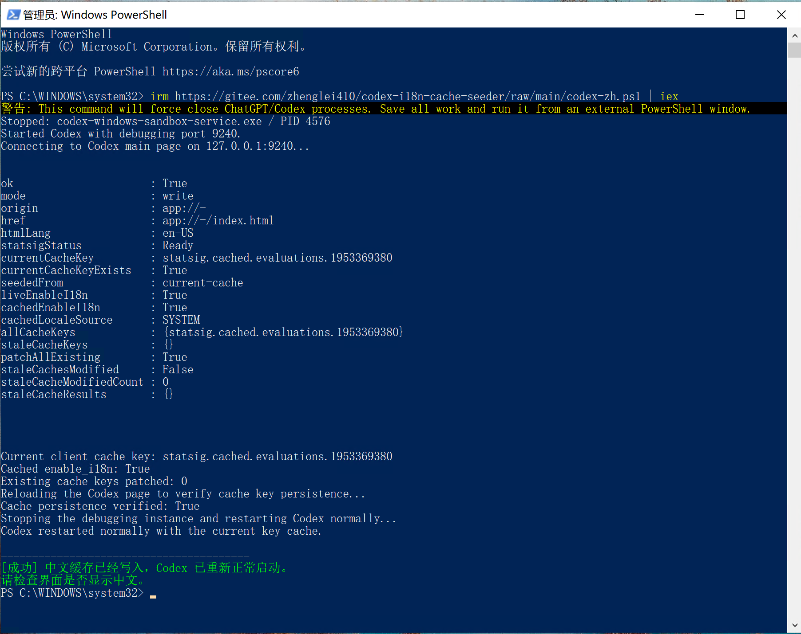

# Codex 中文界面一键修复

让 Windows Codex 桌面版正确使用内置的简体中文语言包。

无需安装，一条 PowerShell 命令即可写入当前客户端缓存、验证结果，并自动重启
Codex。

[](LICENSE)

- Gitee：<https://gitee.com/zhenglei410/codex-i18n-cache-seeder>
- GitHub：<https://github.com/zhenglei410/codex-i18n-cache-seeder>



## 一行运行

先保存工作。点击开始菜单，搜索 `PowerShell`，**不要使用 Codex 内置终端**。

在 Windows PowerShell 中粘贴：

```powershell
irm https://gitee.com/zhenglei410/codex-i18n-cache-seeder/raw/main/codex-zh.ps1 | iex
```

命令会关闭当前 Codex，写入中文缓存，验证缓存已经落盘，然后自动重新打开 Codex。

成功时显示：

```text
[成功] 中文缓存已经写入，Codex 已重新正常启动。
请检查界面是否显示中文。
```

失败时显示：

```text
[失败] 中文缓存修复未完成。
原因：...
```

## 解决什么问题

Codex 桌面包已经包含简体中文资源，但界面是否启用由 Statsig Layer
`72216192` 的 `enable_i18n` 控制。远程配置不可用或客户端缓存键变化时，界面会
回退英文。

本项目解决以下情况：

- 已设置 `localeOverride = "zh-CN"`，但界面仍是英文；
- 配置文件中看起来正常，客户端却没有加载中文；
- 机器上存在旧账号留下的缓存键，工具只改旧键造成“假成功”；
- Codex 更新后缓存键变化，需要重新写入当前键。

## 它做了什么

1. 完全关闭旧的 ChatGPT / Codex 进程；
2. 等待 Statsig Client 进入 `Ready`；
3. 计算当前真实缓存键：

   ```javascript
   client.dataAdapter._getCacheKey(context.user)
   ```

4. 写入当前缓存键；
5. 同时修复所有已有的历史评估缓存键；
6. 刷新 Codex 主页面并重新连接验证；
7. 确认 `enable_i18n=true` 后，正常重启 Codex；
8. 最后显示中文成功或失败结果。

只写当前键时可以使用：

```powershell
$u = 'https://gitee.com/zhenglei410/codex-i18n-cache-seeder/raw/main/current-key/Enable-CodexI18nCurrentCache.ps1'
$text = (Invoke-RestMethod $u).TrimStart([char]0xFEFF)
& ([scriptblock]::Create($text)) -CurrentKeyOnly -NoLaunch -Port 9240
```

## 支持环境

- Windows 10 / Windows 11；
- Microsoft Store / MSIX 版 `OpenAI.Codex`；
- Windows PowerShell 5.1 或 PowerShell 7；
- 建议退出 CC Switch 托盘，避免它重新启动 Codex。

## 安全边界

- 不修改 `app.asar`、WindowsApps 或 Codex 安装文件；
- 不读取或上传 API Key、登录令牌和对话内容；
- 不修改模型提供商；
- 不安装后台服务、自启动项或托盘程序；
- 只通过 `127.0.0.1` 连接本地 Codex 调试端口；
- 缓存只会影响本机 Codex 桌面界面。

## 说明

- 这是非官方社区工具，与 OpenAI 无隶属关系。
- 聊天正文、模型回复、代码和命令输出不属于桌面 UI 翻译范围。
- 少量新面板仍显示英文，可能是当前 Codex 版本尚未提供对应中文词条。
- Codex 更新后如果再次回退英文，重新运行同一条命令即可。

旧版命令 URL 仍然兼容，但内部已经转发到当前版本。历史实现和迁移说明见
[legacy/README.md](legacy/README.md)。

如果这个工具帮你恢复了中文界面，欢迎 Star 支持项目。

## License

[MIT](LICENSE)
