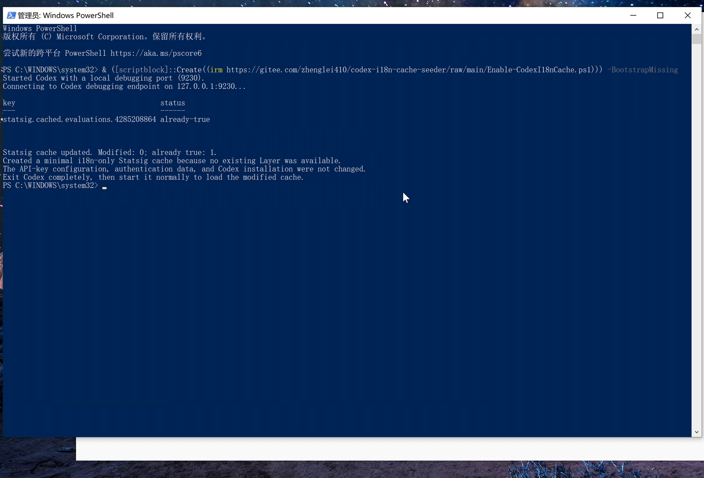

# Codex 中文缓存种子工具

一个面向 Windows Codex 桌面版的轻量工具，用于把 Statsig 的
`enable_i18n` 开关写为 `true`，让已经内置中文语言包的 Codex 正常显示中文界面。

脚本是自包含的单文件 PowerShell 程序。它不会修改 Codex 安装目录、API Key、
模型提供商或认证信息，也不安装后台服务、托盘程序或长期注入器。

[MIT License](LICENSE)

- Gitee：<https://gitee.com/zhenglei410/codex-i18n-cache-seeder>
- GitHub：<https://github.com/zhenglei410/codex-i18n-cache-seeder>



> 截图中的 `Modified: 0; already true: 1` 也是成功状态：最小缓存已经创建，
> 目标 Layer 在创建时已经是 `enable_i18n=true`。

## 先看结论

推荐直接运行“缺失时创建最小缓存”模式。它同时兼容两种环境：

1. 已有 Statsig 缓存：只修改 `enable_i18n`，保留其他缓存内容；
2. 完全没有 Statsig 评估值：创建一份只包含中文开关的最小缓存。

运行前必须**完全退出 Codex**，并在独立的 Windows PowerShell 窗口中执行：

```powershell
$u = 'https://gitee.com/zhenglei410/codex-i18n-cache-seeder/raw/main/Enable-CodexI18nCache.ps1'
& ([scriptblock]::Create((Invoke-RestMethod $u))) -BootstrapMissing
```

看到类似下面的结果即表示缓存写入成功：

```text
Statsig cache updated. Modified: 0; already true: 1.
Created a minimal i18n-only Statsig cache because no existing Layer was available.
The API-key configuration, authentication data, and Codex installation were not changed.
```

随后：

1. 完全退出 Codex；
2. 正常启动 Codex；
3. 检查界面是否显示中文。

## 它是怎么工作的

Codex 桌面版自带 `zh-CN` 语言资源，但会通过 Statsig Layer `72216192`
判断是否加载本地化消息：

```text
layer_configs["72216192"] -> enable_i18n = true
locale_source = "SYSTEM"
```

脚本会临时带本地 CDP 调试端口启动同一个 Codex，然后：

1. 等待 `app://-/index.html` 出现；
2. 查找 `statsig.cached.evaluations.*`；
3. 找到 Layer `72216192`；
4. 默认模式只修改 `enable_i18n=true`；
5. 如果没有缓存，但 Statsig Client 已有内存评估值，则用该值生成当前电脑的缓存；
6. 使用 `-BootstrapMissing` 且没有任何可用评估缓存时，创建最小 `init-v2` 缓存；
7. 写入完成后退出，不保持注入会话。

`-BootstrapMissing` 生成的缓存只包含中文 Layer，不伪造其他功能开关：

```json
{
  "has_updates": true,
  "response_format": "init-v2",
  "layer_configs": {
    "72216192": {
      "v": "0",
      "r": "codex-i18n-cache-bootstrap",
      "s": [],
      "is_device_based": true
    }
  },
  "values": {
    "0": {
      "enable_i18n": true,
      "locale_source": "SYSTEM"
    }
  }
}
```

## 环境要求

- Windows 10 或 Windows 11；
- 微软商店 / MSIX 版 Codex，包名 `OpenAI.Codex`；
- Windows PowerShell 5.1 或 PowerShell 7；
- 能从 Gitee 下载脚本，或已经在本地保存脚本；
- 运行前完全退出 Codex；
- Codex 继续使用你现有的 API Key / 模型提供商配置。

不要从 Codex 内置终端运行本工具，因为该终端会随着 Codex 退出而关闭。

## 推荐用法

### 模式一：缺失时自动创建

适用于首次使用、英文界面、没有 Statsig 缓存，或此前出现
`hasContextValues=False`、`targetLayerState=missing` 的电脑。

```powershell
$u = 'https://gitee.com/zhenglei410/codex-i18n-cache-seeder/raw/main/Enable-CodexI18nCache.ps1'
& ([scriptblock]::Create((Invoke-RestMethod $u))) -BootstrapMissing
```

### 模式二：只修改现有缓存

适用于已经有 Statsig 缓存、只希望打开中文开关的电脑：

```powershell
Invoke-RestMethod 'https://gitee.com/zhenglei410/codex-i18n-cache-seeder/raw/main/Enable-CodexI18nCache.ps1' | Invoke-Expression
```

如果电脑上根本没有缓存，此模式会明确报错，而不会自行创建。此时改用模式一。

### 本地文件

```powershell
Set-Location 'C:\path\to\codex-i18n-cache-seeder'
pwsh -NoProfile -File .\Enable-CodexI18nCache.ps1 -BootstrapMissing
```

也可以双击 `Run.cmd`，再在弹窗中使用默认参数执行。

## 参数

| 参数 | 作用 |
| --- | --- |
| `-BootstrapMissing` | 没有任何可用 Statsig 缓存时，创建最小中文缓存 |
| `-Port 9230` | 指定本地 CDP 端口 |
| `-TimeoutSeconds 60` | 设置等待 Codex 和 CDP 的超时时间 |
| `-NoLaunch` | 只连接已经带调试端口运行的 Codex |
| `-Reload` | 写入后立即刷新页面。正常重启仍然更可靠 |

需要传参数时，使用 `scriptblock` 形式：

```powershell
$u = 'https://gitee.com/zhenglei410/codex-i18n-cache-seeder/raw/main/Enable-CodexI18nCache.ps1'
& ([scriptblock]::Create((Invoke-RestMethod $u))) -BootstrapMissing -Port 9230 -TimeoutSeconds 90
```

## 成功后的配置检查

Codex 的官方桌面语言设置应包含：

```toml
[desktop]
localeOverride = "zh-CN"
```

检查命令：

```powershell
$config = Join-Path $HOME '.codex\config.toml'
Select-String -Path $config -Pattern '^\s*localeOverride\s*=' -ErrorAction SilentlyContinue
```

如果找不到这一项，可在 Codex 的语言设置中选择简体中文；也可以手动在
`[desktop]` 段加入：

```toml
localeOverride = "zh-CN"
```

修改配置后仍需完全退出并重新启动 Codex。

## 常见错误与处理方法

### 1. `PropertyNotFoundStrict`：找不到 `error` 或 `entries`

这是旧版脚本在 PowerShell 严格模式下访问可选 CDP 字段导致的：

```text
在此对象上找不到属性“error”
在此对象上找不到属性“entries”
```

处理方法：重新获取最新版脚本，不要继续使用旧变量中的代码：

```powershell
Remove-Variable script -ErrorAction SilentlyContinue
$u = 'https://gitee.com/zhenglei410/codex-i18n-cache-seeder/raw/main/Enable-CodexI18nCache.ps1'
& ([scriptblock]::Create((Invoke-RestMethod $u))) -BootstrapMissing
```

### 2. `无效的 JSON 基元: System.Threading.Tasks.VoidTaskResult`

原因是旧版 PowerShell 把 `SendAsync().GetResult()` 的异步返回值混进了 JSON
结果流。新版已显式丢弃该返回值并只接受字符串结果。

处理方法仍是重新获取最新版后运行：

```powershell
$u = 'https://gitee.com/zhenglei410/codex-i18n-cache-seeder/raw/main/Enable-CodexI18nCache.ps1'
& ([scriptblock]::Create((Invoke-RestMethod $u))) -BootstrapMissing
```

### 2.1 `ScriptBlock::Create` 在 `[CmdletBinding()]` 处解析失败

如果出现：

```text
“（”后面应为表达式
[int]$Port = 0
赋值表达式无效
```

通常是下载到的脚本文本开头带有 UTF-8 BOM。最新版文件已改为无 BOM。
重新下载最新版即可。如果仍需防御当前缓存文本，可以先去掉 BOM：

```powershell
$u = 'https://gitee.com/zhenglei410/codex-i18n-cache-seeder/raw/main/Enable-CodexI18nCache.ps1'
$text = (Invoke-RestMethod $u).TrimStart([char]0xFEFF)
& ([scriptblock]::Create($text)) -BootstrapMissing
```

### 3. `Codex is already running without the required debugging port`

Codex 已经在没有调试端口的情况下运行。先保存工作，完全退出 Codex，再重新执行。

可以检查主进程：

```powershell
Get-CimInstance Win32_Process -Filter "Name='ChatGPT.exe'" |
    Where-Object { $_.CommandLine -notmatch '--type=' } |
    Select-Object ProcessId, CommandLine
```

确实已经保存工作后，可以用命令关闭 Codex：

```powershell
Get-Process ChatGPT -ErrorAction SilentlyContinue | Stop-Process
```

优先从 Codex 界面或托盘正常退出，强制结束进程可能丢失未保存内容。

### 4. 端口 `9230` 被占用

检查监听端口：

```powershell
Get-NetTCPConnection -LocalPort 9230 -State Listen -ErrorAction SilentlyContinue
```

换一个端口运行：

```powershell
$u = 'https://gitee.com/zhenglei410/codex-i18n-cache-seeder/raw/main/Enable-CodexI18nCache.ps1'
& ([scriptblock]::Create((Invoke-RestMethod $u))) -BootstrapMissing -Port 9240
```

### 5. `Codex did not expose an app:// page through CDP`

常见原因是 Codex 尚未加载完成、旧进程仍占用单实例，或调试端口没有成功传入。

先完全退出 Codex，再增加超时时间：

```powershell
$u = 'https://gitee.com/zhenglei410/codex-i18n-cache-seeder/raw/main/Enable-CodexI18nCache.ps1'
& ([scriptblock]::Create((Invoke-RestMethod $u))) -BootstrapMissing -TimeoutSeconds 120
```

如果 Codex 已经手动带调试端口启动，可以仅连接现有实例：

```powershell
$u = 'https://gitee.com/zhenglei410/codex-i18n-cache-seeder/raw/main/Enable-CodexI18nCache.ps1'
& ([scriptblock]::Create((Invoke-RestMethod $u))) -BootstrapMissing -NoLaunch -Port 9230
```

### 5.1 `ConnectAsync` 报“无法连接到远程服务器”或 WebSocket 被关闭

这表示 HTTP 调试接口可能已经出现，但页面 WebSocket target 已失效，或者返回的地址
使用 `localhost`，而 Windows 将其解析到 IPv6 `::1`。新版脚本会：

- 将 `ws://localhost:...` 和 `ws://[::1]:...` 强制改为 `ws://127.0.0.1:...`；
- 显式禁用系统代理，避免本地 `127.0.0.1` WebSocket 被代理转发；
- 最多重新获取 4 次 Codex 页面 target；
- 在 WebSocket 连接失败后自动重连。

更新脚本并换端口运行：

```powershell
$u = 'https://gitee.com/zhenglei410/codex-i18n-cache-seeder/raw/main/Enable-CodexI18nCache.ps1'
& ([scriptblock]::Create((Invoke-RestMethod $u))) -BootstrapMissing -Port 9240 -TimeoutSeconds 120
```

### 6. `No Statsig evaluation cache was found`

先看诊断字段：

```text
hasStatsigRoot
hasStatsigClient
statsigStatus
hasContextValues
contextHasUpdates
targetLayerState
```

如果出现下面组合：

```text
hasStatsigClient  : True
statsigStatus     : Ready
hasContextValues  : False
targetLayerState  : missing
```

说明 Statsig 客户端已初始化，但服务器没有返回任何评估值，目标 Layer 根本不存在。
这时没有“原缓存”可修改，必须使用：

```powershell
$u = 'https://gitee.com/zhenglei410/codex-i18n-cache-seeder/raw/main/Enable-CodexI18nCache.ps1'
& ([scriptblock]::Create((Invoke-RestMethod $u))) -BootstrapMissing
```

### 7. 命令提示成功，但界面仍然是英文

依次检查：

1. 是否已经完全退出并重新启动 Codex，而不是只刷新页面；
2. `localeOverride` 是否为 `zh-CN`；
3. 是否同时运行了多个 Codex 实例；
4. 是否从 Codex 内置终端而不是外部 PowerShell 运行；
5. 重新运行带 `-BootstrapMissing` 的命令。

检查语言配置：

```powershell
Select-String -Path (Join-Path $HOME '.codex\config.toml') -Pattern 'localeOverride'
```

### 8. 中文后来又变回英文

Statsig 缓存不是永久配置。如果 Codex 后续成功联网并收到
`enable_i18n=false`，服务器结果可能覆盖本地缓存。

重新运行：

```powershell
$u = 'https://gitee.com/zhenglei410/codex-i18n-cache-seeder/raw/main/Enable-CodexI18nCache.ps1'
& ([scriptblock]::Create((Invoke-RestMethod $u))) -BootstrapMissing
```

### 9. 无法下载脚本、TLS 或执行策略错误

Windows PowerShell 5.1 可先启用 TLS 1.2：

```powershell
[Net.ServicePointManager]::SecurityProtocol = [Net.SecurityProtocolType]::Tls12
```

如果本地脚本因执行策略无法运行，可仅对当前 PowerShell 进程放宽策略：

```powershell
Set-ExecutionPolicy -Scope Process -ExecutionPolicy Bypass
```

也可以显式启动 PowerShell：

```powershell
powershell -NoProfile -ExecutionPolicy Bypass -File .\Enable-CodexI18nCache.ps1 -BootstrapMissing
```

### 10. 需要确认下载的脚本版本

下载到本地后核对 SHA256：

```powershell
Get-FileHash .\Enable-CodexI18nCache.ps1 -Algorithm SHA256
```

本文档发布时，脚本 SHA256 为：

```text
7F4E68905151BDB326CD9405851374AAEB38B11305C72148EFCE144730C598E2
```

脚本后续更新后，以仓库 `main` 分支的 `Enable-CodexI18nCache.ps1`
文件为准。

## 安全边界

该工具：

- 只使用 `127.0.0.1` 上的临时 CDP 端口；
- 不修改 `app.asar`、WindowsApps 或 MSIX 安装包；
- 不修改 API Key、认证信息或模型提供商；
- 不安装服务、自启动项或托盘程序；
- 不持续覆盖 Statsig 内存对象；
- 默认只修改现有缓存中的 `enable_i18n`；
- 仅在显式使用 `-BootstrapMissing` 时创建最小中文缓存。

`irm ... | iex` 会直接执行远程 PowerShell 内容。请只运行来自本项目固定地址、
经过审查的脚本。正式分发时推荐同时发布版本号和 SHA256。

## 为什么它不是永久方案

这里写入的是 Statsig 缓存，不是 Codex 的永久功能开关。以下情况可能使缓存失效
或被覆盖：

- Codex 更新；
- Statsig SDK、缓存格式或 Layer 编号变化；
- 成功联网后服务器返回新的评估结果；
- 清除 Codex 站点数据；
- `stableID`、账号或 SDK Key 发生变化。

需要跨更新永久强制时，应使用持续注入或修改应用程序的方案。本项目刻意保持为
一次性缓存工具，尽量减少对 Codex 本体和认证环境的影响。

## 项目文件

| 文件 | 说明 |
| --- | --- |
| `Enable-CodexI18nCache.ps1` | 自包含主程序 |
| `Run.cmd` | Windows 双击启动入口 |
| `docs/images/success.png` | 成功运行截图 |
| `LICENSE` | MIT 许可证 |

## 开发与回归

当前实现已覆盖以下回归场景：

- 直接修改已有 `statsig.cached.evaluations.*`；
- 处理 Layer 名称和 Statsig DJB2 哈希名称；
- 从 Ready Statsig Client 的内存数据生成缓存；
- 没有任何评估值时创建最小 `init-v2` 缓存；
- PowerShell 5.1 / 7 解析和严格模式；
- CDP 响应中的可选字段与异步返回值；
- 确认除目标 `enable_i18n` 外的已有字段保持不变。

本项目是非官方社区工具，与 OpenAI 无隶属关系。
